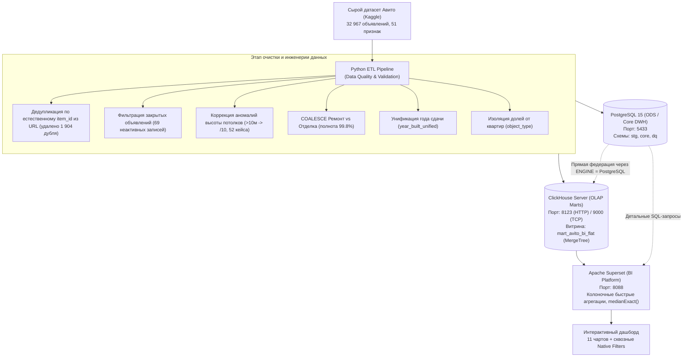

# 🏠 Мониторинг рынка недвижимости Санкт-Петербурга (Авито Недвижимость)

[](https://superset.apache.org/)
[](https://clickhouse.com/)
[](https://www.postgresql.org/)
[](https://www.python.org/)
[](https://www.docker.com/)

Инженерно-аналитический пет-проект полного цикла для отбора на программу **Avito Bootcamp (BI-разработчик / Data Analyst)**.  
Проект демонстрирует проектирование хранилища данных (DWH), разработку ETL-пайплайна с контролем качества (Data Quality) на сырых данных парсинга объявлений, развёртывание корпоративной аналитической платформы **Apache Superset** и сборку интерактивного бизнес-дашборда.

---

## 🏗 Архитектура решения



---

## 📊 Интерактивный BI-дашборд в Apache Superset

Дашборд развернут в Apache Superset и доступен по адресу:  
👉 **`http://localhost:8088/superset/dashboard/avito-spb-real-estate/`**

### 1. Главный экран мониторинга (Городской масштаб — 31 000 объектов)
* **Верхнеуровневые KPI:** 30 994 проверенных объекта, медиана **271 686 ₽/м²**, медианный бюджет **12 500 000 ₽**, средняя площадь **47.2 м²**.
* **Рейтинг всех 17 районов СПб:** визуализация цен квадратного метра (топ: *Петроградский* — 539.8 тыс. ₽, *Василеостровский* — 380.2 тыс. ₽, *Адмиралтейский* — 368.4 тыс. ₽, *Центральный* — 350.8 тыс. ₽; замыкают: *Петродворцовый* — 194.2 тыс. ₽ и *Колпинский* — 187.8 тыс. ₽).
* **Структура предложения по комнатности:** Donut-диаграмма распределения (1к — 30%, 2к — 28%, студии — 19%, 3к — 18%, 4к+ — 5%).

<p align="center">
  
</p>

### 2. Углубленные аналитические срезы
* **Влияние удаленности от метро:** распределение стоимости кв. метра в группах шаговой доступности (`до 10 мин`, `11-20 мин`, `21-30 мин`, `> 30 мин`).
* **Цены по эпохам постройки:** динамика цен м² в новом фонде (>2015 — 308 тыс. ₽), дореволюционных домах (<1917 — 269 тыс. ₽), современной застройке (1991–2015 — 247 тыс. ₽) и советском фонде (1918–1990 — 194 тыс. ₽).
* **Премия за состояние объекта:** сравнительный анализ медианы м² для дизайнерского ремонта (364 тыс. ₽) и евроремонта (325 тыс. ₽) против жилья без ремонта / черновой отделки (240 тыс. ₽).
* **Топ-15 станций метро по стоимости кв. метра:** рейтинг среди всех 66 станций с числом лотов и бюджетом (*Крестовский остров* — 617 тыс. ₽, *Спортивная* — 582 тыс. ₽, *Чкаловская* — 530 тыс. ₽, *Петроградская* — 491 тыс. ₽).

<p align="center">
  
</p>

### 3. Интерактивная фильтрация и сквозной Drill-down (Cross-Filtering)
Боковая панель **Native Filters** и сквозной клик по графикам позволяют исследовать любой локальный сегмент рынка. При выборе среза (например: *Выборгский район, 2–3 комнатные квартиры, вторичка, советский период*) все 11 чартов синхронно пересчитываются:
* Выборка мгновенно сужается до **269 целевых объектов**;
* Медиана стоимости метра в этом сегменте корректируется до **193 622 ₽/м²**;
* Рейтинг метро перестраивается только по станциям Выборгского района (*Площадь Ленина, Выборгская, Политехническая, Пионерская, Удельная, Лесная, Озерки, Проспект Просвещения*).

<p align="center">
  
</p>

<p align="center">
  
</p>

---

## 🚀 Быстрый запуск проекта

### 1. Требования
* Docker Desktop & Docker Compose
* Python 3.10+

### 2. Клонирование и запуск окружения
```bash
# Запуск контейнеров (Postgres, ClickHouse, Redis, Superset)
docker compose up -d
```

### 3. Запуск ETL-пайплайна
```bash
# Установка зависимостей скрипта
pip install -r etl/requirements.txt

# Прогон очистки данных и загрузки в DWH
python etl/pipeline.py data/raw/avito_clean_final_full.xlsx
```

### 4. Вход в Apache Superset
* **URL:** `http://localhost:8088`
* **Логин:** `admin`
* **Пароль:** `admin`
* **Прямая ссылка на дашборд:** `http://localhost:8088/superset/dashboard/avito-spb-real-estate/`

---

## 🔍 Ключевые Data Quality инсайты (Ценность для BI)

1. **Изоляция долей от квартир:** В сыром датасете 20 объявлений о продаже долей (комнат) содержали площадь всей многокомнатной квартиры (до 197 м²), из-за чего цена м² падала до **11 410 ₽/м²**. Выделение признака `object_type = 'Доля'` нормализовало медианы по районам.
2. **Дедупликация dynamic context:** Авито генерирует уникальные ссылки за счёт токена `?context=...`. Парсинг натурального `item_id` регулярным выражением выявил 17 задублированных пар объявлений.
3. **Объединение взаимоисключающих полей (`COALESCE`):** Признак `Ремонт` (вторичка) и `Отделка` (первичка) были разнесены в разные столбцы. Их объединение повысило заполненность с 86.2% до 99.7%.

---

## 📁 Структура репозитория

```text
├── docker-compose.yml              # Оркестрация стека (Postgres, ClickHouse, Redis, Superset)
├── docker/
│   ├── superset/
│   │   ├── Dockerfile              # Superset с драйверами ClickHouse и Postgres
│   │   ├── superset_config.py      # Конфигурация кэша Redis, CORS и безопасности
│   │   ├── docker-init.sh          # Скрипт миграций БД и создания admin
│   │   ├── register_datasources.py # Регистрация подключений и метрик в Superset
│   │   └── create_dashboard.py     # Автосборка чартов и структуры дашборда
│   └── postgres/
│       └── init-databases.sh       # Инициализация баз superset и avito_dwh
├── sql/
│   ├── postgres/
│   │   └── 01_init_schema.sql      # DDL схемы (stg, core, dq)
│   └── clickhouse/
│       └── 01_init_marts.sql       # DDL аналитической витрины (MergeTree)
├── etl/
│   ├── pipeline.py                 # Полный ETL: очистка, feature engineering, загрузка
│   └── requirements.txt            # Python-зависимости ETL
├── dashboards/
│   └── avito_spb_dashboard_export.zip # Экспортированный архив дашборда Superset
└── .gitignore                      # Исключения Git
```

