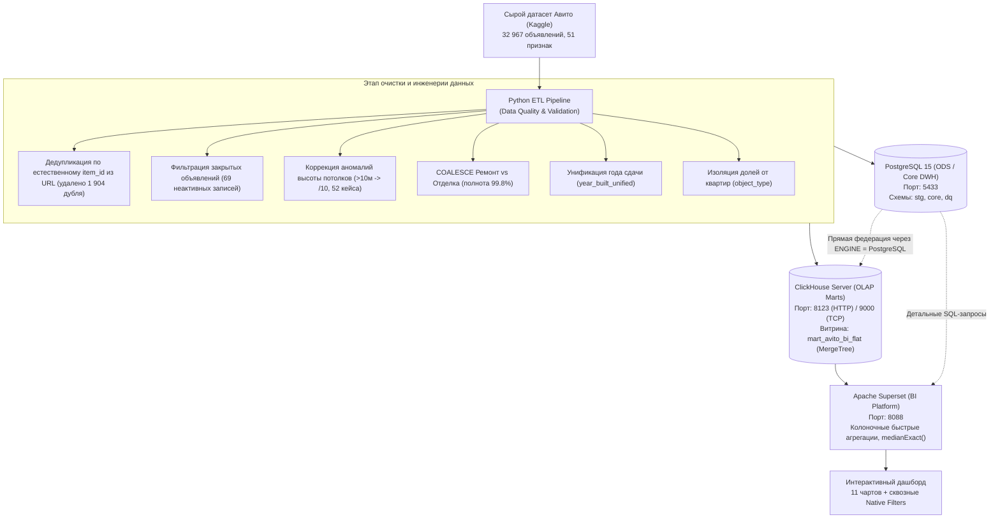

# 🏠 Мониторинг рынка недвижимости Санкт-Петербурга (Авито Недвижимость)

[](https://superset.apache.org/)
[](https://clickhouse.com/)
[](https://www.postgresql.org/)
[](https://www.python.org/)
[](https://www.docker.com/)

Инженерно-аналитический пет-проект полного цикла для отбора на программу **Avito Bootcamp (BI-разработчик / Data Analyst)**.  
Проект демонстрирует проектирование хранилища данных (DWH), разработку ETL-пайплайна с контролем качества (Data Quality) на сырых данных парсинга объявлений, развёртывание корпоративной аналитической платформы **Apache Superset** и сборку интерактивного бизнес-дашборда.

---

## 🏗 Архитектура решения



---

## 📊 Состав дашборда

Дашборд доступен по адресу: `http://localhost:8088/superset/dashboard/avito-spb-real-estate/`

### 1. KPI-карточки верхнего уровня (Big Numbers)
* **Всего проверенных объявлений:** 30 994 чистых объекта (после дедупликации и фильтрации).
* **Медианная цена кв. метра:** 270 440 ₽/м².
* **Медианный бюджет объекта:** 12 500 000 ₽.
* **Медианная площадь:** 48.3 м².

### 2. Аналитические визуализации
* **Медианная стоимость м² по районам СПб:** рейтинг всех 17 районов Санкт-Петербурга (топ: Петроградский — 539 тыс. ₽/м², Василеостровский — 380 тыс. ₽/м², Адмиралтейский — 368 тыс. ₽/м², Центральный — 351 тыс. ₽/м²; замыкают: Петродворцовый — 194 тыс. ₽/м², Колпинский — 188 тыс. ₽/м²).
* **Структура предложения по комнатности (Donut chart):** распределение 1к (9.3k), 2к (8.5k), студий (5.9k), 3к (5.6k), 4к+ (1.6k).
* **Влияние удаленности от метро на цену:** динамика цены м² в группах `до 10 мин`, `11-20 мин`, `21-30 мин`, `> 30 мин`.
* **Ценообразование по эпохам постройки:** новый фонд (>2015, 18.5k лотов), советский период (1918–1990, 4.6k лотов), современная застройка (1991–2015, 3.7k лотов), дореволюционный фонд (<1917, 2.1k лотов).
* **Премия за состояние объекта:** сравнение стоимости м² для дизайнерского, евроремонта, косметического и черновой отделки.
* **Топ-15 станций метро по стоимости кв. метра:** рейтинг среди 66 станций с числом лотов и бюджетом.
* **Детальный реестр объявлений (Таблица):** интерактивный список объектов с ценами, площадью и характеристиками.

### 3. Сквозные фильтры (Native Filters)
* Выбор района СПб (`district`, 17 районов)
* Количество комнат (`rooms_count`)
* Тип рынка (`market_type`: Вторичка / Новостройка)
* Тип объекта (`object_type`: Квартира / Апартаменты / Доля)
* Эпоха постройки (`building_era`)
* Удаленность от метро (`metro_time_group`)
* Диапазон цены м² (`price_per_sqm`, слайдер)

---

## 🚀 Быстрый запуск проекта

### 1. Требования
* Docker Desktop & Docker Compose
* Python 3.10+

### 2. Клонирование и запуск окружения
```bash
# Запуск контейнеров (Postgres, ClickHouse, Redis, Superset)
docker compose up -d
```

### 3. Запуск ETL-пайплайна
```bash
# Установка зависимостей скрипта
pip install -r etl/requirements.txt

# Прогон очистки данных и загрузки в DWH
python etl/pipeline.py data/raw/avito_clean_final_full.xlsx
```

### 4. Вход в Apache Superset
* **URL:** `http://localhost:8088`
* **Логин:** `admin`
* **Пароль:** `admin`
* **Прямая ссылка на дашборд:** `http://localhost:8088/superset/dashboard/avito-spb-real-estate/`

---

## 🔍 Ключевые Data Quality инсайты (Ценность для BI)

1. **Изоляция долей от квартир:** В сыром датасете 20 объявлений о продаже долей (комнат) содержали площадь всей многокомнатной квартиры (до 197 м²), из-за чего цена м² падала до **11 410 ₽/м²**. Выделение признака `object_type = 'Доля'` нормализовало медианы по районам.
2. **Дедупликация dynamic context:** Авито генерирует уникальные ссылки за счёт токена `?context=...`. Парсинг натурального `item_id` регулярным выражением выявил 17 задублированных пар объявлений.
3. **Объединение взаимоисключающих полей (`COALESCE`):** Признак `Ремонт` (вторичка) и `Отделка` (первичка) были разнесены в разные столбцы. Их объединение повысило заполненность с 86.2% до 99.7%.

---

## 📁 Структура репозитория

```text
├── docker-compose.yml              # Оркестрация стека (Postgres, ClickHouse, Redis, Superset)
├── docker/
│   ├── superset/
│   │   ├── Dockerfile              # Superset с драйверами ClickHouse и Postgres
│   │   ├── superset_config.py      # Конфигурация кэша Redis, CORS и безопасности
│   │   ├── docker-init.sh          # Скрипт миграций БД и создания admin
│   │   ├── register_datasources.py # Регистрация подключений и метрик в Superset
│   │   └── create_dashboard.py     # Автосборка чартов и структуры дашборда
│   └── postgres/
│       └── init-databases.sh       # Инициализация баз superset и avito_dwh
├── sql/
│   ├── postgres/
│   │   └── 01_init_schema.sql      # DDL схемы (stg, core, dq)
│   └── clickhouse/
│       └── 01_init_marts.sql       # DDL аналитической витрины (MergeTree)
├── etl/
│   ├── pipeline.py                 # Полный ETL: очистка, feature engineering, загрузка
│   └── requirements.txt            # Python-зависимости ETL
├── dashboards/
│   └── avito_spb_dashboard_export.zip # Экспортированный архив дашборда Superset
└── .gitignore                      # Исключения Git
```

