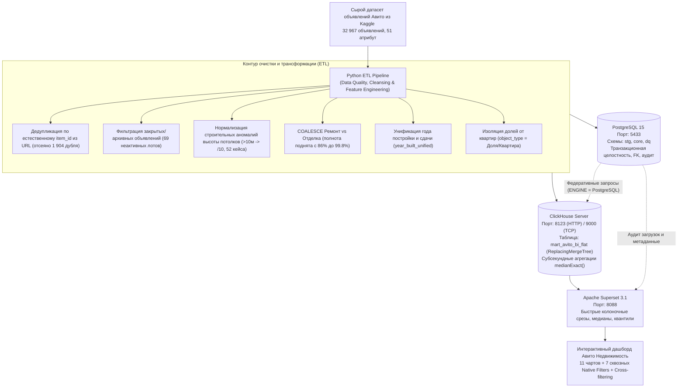
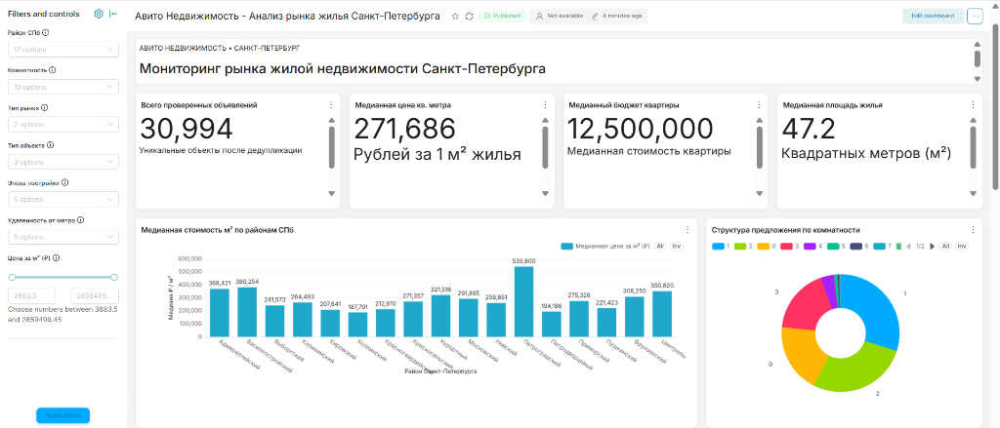
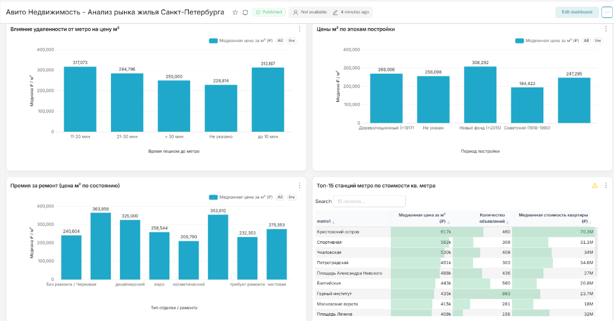
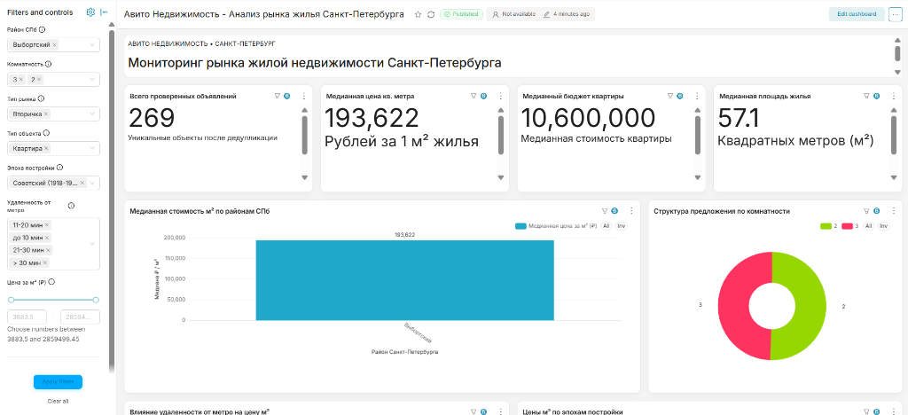
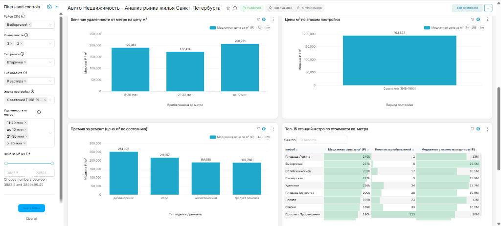

# 🏠 Мониторинг рынка жилой недвижимости Санкт-Петербурга (Авито Недвижимость)

[](https://superset.apache.org/)
[](https://clickhouse.com/)
[](https://www.postgresql.org/)
[](https://www.python.org/)
[-brightgreen?logo=pytest&logoColor=white)](https://docs.pytest.org/)
[](https://www.docker.com/)

Продакшн-ориентированный аналитический проект полного цикла: от очистки и валидации сырых данных парсинга **33 000+ объявлений Авито**, проектирования двухуровневого хранилища данных (**PostgreSQL ODS + ClickHouse OLAP**) до интерактивного BI-дашборда в корпоративной дизайн-системе **Apache Superset**, прикладных продуктовых SQL-моделей и автотестов качества данных (**Data Quality & Integrity Testing**).

---

## 📌 Оглавление
1. [Архитектура решения](#-архитектура-решения)
2. [Интерактивный BI-дашборд в Apache Superset](#-интерактивный-bi-дашборд-в-apache-superset)
3. [Ключевые бизнес-инсайты исследования рынка СПб](#-ключевые-бизнес-инсайты-исследования-рынка-спб)
4. [Быстрый запуск (One-Click)](#-быстрый-запуск-проекта)
5. [Data Quality: очистка данных и тестирование (Pytest)](#-data-quality-очистка-данных-и-тестирование)
6. [Продуктовые SQL-модели (ClickHouse & Postgres)](#-продуктовые-sql-модели-sqlanalytics_queriessql)
7. [Технологический стек и обоснование](#-технологический-стек-и-обоснование)
8. [Структура репозитория](#-структура-репозитория)
9. [Описание проекта для резюме (CV Bullet Points)](#-описание-проекта-для-резюме)

---

## Архитектура решения




---

## 📊 Интерактивный BI-дашборд в Apache Superset

Дашборд доступен локально по адресу:  
 **`http://localhost:8088/superset/dashboard/avito-spb-real-estate/`**  
*(Логин: `admin`, Пароль: `admin`)*

### 1. Главный экран мониторинга 
* **30 994** проверенных уникальных лота, общегородская медиана - **271 686 ₽/м²**, медианный бюджет покупки - **12 500 000 ₽**, средняя площадь - **47.2 м²**.
* **Рейтинг всех 17 районов Санкт-Петербурга:** визуализация стоимости метра от элитных локаций (*Петроградский* - 539.8 тыс. ₽/м², *Василеостровский* - 380.3 тыс. ₽, *Адмиралтейский* - 368.4 тыс. ₽, *Центральный* - 350.8 тыс. ₽) до спальных и пригородных (*Петродворцовый* - 194.2 тыс. ₽, *Колпинский* - 187.8 тыс. ₽).
* **Структура предложения по комнатности:** распределение лотов в структуре рынка (1-комнатные - 30.5%, 2-комнатные - 27.8%, студии - 18.9%, 3-комнатные - 17.6%, 4к+ - 5.2%).

<p align="center">
  
</p>

### 2. Аналитические факторы ценообразования 
* **Фактор транспортной доступности:** расчет стоимости метра в зависимости от шаговой доступности метро (`до 10 мин` - 313.2 тыс. ₽/м², `11-20 мин` - 317.1 тыс. ₽/м², `21-30 мин` - 284.8 тыс. ₽/м², `> 30 мин` - 250.0 тыс. ₽/м²).
* **Фактор эпохи постройки:** дифференциация цен между Новым фондом (>2015 - 308.3 тыс. ₽), Дореволюционным фондом (<1917 - 269.0 тыс. ₽), Современной застройкой (1991–2015 - 247.3 тыс. ₽) и Советским фондом (1918–1990 - 194.4 тыс. ₽).
* **Рыночная премия за состояние:** оценка влияния ремонта на стоимость метра (дизайнерский - 364.0 тыс. ₽, евроремонт - 325.0 тыс. ₽ против 240.6 тыс. ₽ без ремонта).
* **Топ-15 станций метро по стоимости жилья:** рейтинг среди 66 станций СПб (*Крестовский остров* - 617 тыс. ₽/м², *Спортивная* - 582 тыс. ₽, *Чкаловская* - 530 тыс. ₽, *Петроградская* - 491 тыс. ₽).

<p align="center">
  
</p>

### 3. Интерактивная фильтрация и сквозной Cross-Filtering
Боковая панель **Native Filters** (Район, Комнатность, Тип рынка, Тип объекта, Эпоха постройки, Удаленность от метро, Слайдер диапазона цены) и поддержка Cross-filtering позволяют детально исследовать любой сегмент рынка.

**Пример сценария инвестора:** срез по *Выборгскому району (2-3 комнатные квартиры, вторичка, советский жилой фонд)*:
* Объем целевой выборки мгновенно сужается с 31 000 до **269 квартир**;
* Медиана стоимости метра пересчитывается до **193 622 ₽/м²**, а бюджет покупки - до **10 600 000 ₽**;
* Таблица станций метро автоматически фильтруется только по станциям Выборгского района (*Площадь Ленина, Выборгская, Политехническая, Пионерская, Удельная, Лесная, Озерки, Проспект Просвещения*).

<p align="center">
  
</p>

<p align="center">
  
</p>

---

## Ключевые бизнес-инсайты исследования рынка СПб

1. **Территориальная поляризация (разрыв в 2.87 раза)**  
   Медианная цена квадратного метра в Петроградском районе (**539 800 ₽/м²**) почти втрое превосходит Колпинский район (**187 791 ₽/м²**). При этом Адмиралтейский и Центральный районы формируют средний бизнес-сегмент (350–370 тыс. ₽/м²).
2. **«Штраф» за первый этаж достигает 31.6%**  
   Квартиры на первом этаже в старом фонде и историческом центре теряют в цене от 25% до 31.6% по отношению к средним типовым этажам. Напротив, в премиальных локациях (Петроградка, Васильевский остров) последний этаж имеет премию **+7%...+11%** (видовые квартиры и мансарды).
3. **Маржинальность отделки и арбитраж флиппинга**  
   В дореволюционных домах разница между квартирой «под ремонт» и дизайнерской отделкой для типового метра составляет **+122 600 ₽/м²** (добавочная стоимость **+6.13 млн ₽** на квартиру 50 м²), что делает флиппинг исторического фонда наиболее маржинальным инвестиционным направлением. В панельном советском фонде аналогичная премия составляет лишь **+3.95 млн ₽**.
4. **Транспортный шаг пешей доступности**  
   Удаление от метро с категории «до 10 минут» в диапазон «более 30 минут» приводит к чистому падению стоимости метра более чем на **63 000 ₽/м²** (-20.2%) при сопоставимых параметрах дома.

---

## Быстрый запуск проекта

### Способ 1: Автоматический One-Click запуск в PowerShell
Скрипт полностью поднимает стек, ждет готовности баз, запускает ETL, настраивает дашборд Superset и прогоняет 12 тестов Data Quality:

```powershell
.\run_all.ps1
```

---

### Способ 2: Пошаговый запуск

#### 1. Требования
* Docker Desktop & Docker Compose
* Python 3.10+

#### 2. Запуск контейнеров
```bash
docker compose up -d
```
*Контейнеры: `avito_postgres` (порт 5433), `avito_clickhouse` (порты 8123, 9000), `avito_redis` (порт 6379), `avito_superset` (порт 8088).*

#### 3. Установка зависимостей и запуск ETL
```bash
pip install -r etl/requirements.txt
python etl/pipeline.py data/raw/avito_clean_final_full.xlsx
```

#### 4. Обновление дашборда и стилей Superset
```bash
docker cp docker/superset/create_dashboard.py avito_superset:/app/create_dashboard.py
docker exec -i avito_superset python /app/create_dashboard.py
```

#### 5. Прогон автотестов Data Quality
```bash
pytest -v tests/test_data_quality.py
```

#### 6. Вход в систему
* **URL:** `http://localhost:8088`
* **Логин / Пароль:** `admin` / `admin`
* **Ссылка на дашборд:** `http://localhost:8088/superset/dashboard/avito-spb-real-estate/`

---

## Data Quality: очистка данных и тестирование

В реальных сырых выгрузках парсинга недвижимости содержится множество дефектов. В рамках ETL-пайплайна реализованы механизмы Data Cleansing:

| Дефект в сырых данных | Риск для аналитики | Реализованное решение |
|---|---|---|
| **URL со случайными UTM-токенами** (`?context=...`) | Искусственное раздувание базы одинаковыми объявлениями | Извлечение натурального числового ID (`re.search(r'_(\d+)(\?|$)')`), дедупликация (**отсеяно 1 904 дубля**) |
| **Доли под видом квартир** | Искажение цен метра: 5 млн за 1/4 доли в 160-метровой квартире давало 31 000 ₽/м² | Классификация `object_type = 'Доля'` и изоляция от рыночной выборки квартир |
| **Опечатки в высоте потолков** | Наличие значений `28.0 м`, `32.0 м` ломало средние | Нормализация значений $>10$ м делением на 10 (`28.0 -> 2.8 м`, 52 случая) |
| **Раздельные поля ремонта** | Вторичка шла в колонке `Ремонт`, новостройки - в `Отделка` (пропуски до 14%) | Слияние через `COALESCE` в `condition_unified` (полнота поднята до **99.8%**) |
| **Архивные закрытые лоты** | Включение снятых объявлений занижало актуальные медианы | Фильтрация неактивных объявлений, **удалено 69 записей** |

### Автоматические тесты (`tests/test_data_quality.py`)
Пайплайн сопровождается набором из **12 unit- и интеграционных тестов**, проверяющих бизнес-инварианты:

```text
tests/test_data_quality.py::test_clean_and_transform_synthetic_data PASSED
tests/test_data_quality.py::test_era_categorization PASSED
tests/test_data_quality.py::test_metro_time_grouping PASSED
tests/test_data_quality.py::test_clickhouse_table_exists_and_populated PASSED
tests/test_data_quality.py::test_clickhouse_no_duplicate_item_ids PASSED
tests/test_data_quality.py::test_clickhouse_price_and_area_ranges PASSED
tests/test_data_quality.py::test_clickhouse_ceiling_height_sanity PASSED
tests/test_data_quality.py::test_clickhouse_kitchen_ratio_sanity PASSED
tests/test_data_quality.py::test_clickhouse_district_coverage PASSED
tests/test_data_quality.py::test_clickhouse_valid_eras_and_metro_buckets PASSED
tests/test_data_quality.py::test_postgres_ods_integrity_and_fks PASSED
tests/test_data_quality.py::test_postgres_etl_audit_log PASSED
============================= 12 passed in 3.35s ==============================
```

---

## 📈 Продуктовые SQL-модели ([`sql/analytics_queries.sql`](file:///d:/Ищем%20работу/Резюмешки/Проекты,%20из%20которых%20собираем%20инфу%20для%20резюме/Avito_saint-petersburg/sql/analytics_queries.sql))

Файл содержит 6 прикладных аналитических запросов для решения реальных бизнес-задач инвесторов, брокеров и аналитиков продукта:

### 1. Инвестиционный скоринг недооцененных лотов (Underpriced Flips)
* **Бизнес-цель:** автоматический поиск квартир, выставленных с дисконтом $\ge 25\%$ от локального бенчмарка *(Район + Метро + Комнатность)*.
* **SQL-техники:** обобщенные табличные выражения (`WITH cluster_stats`), ранжирование через `ROW_NUMBER() OVER (PARTITION BY district ORDER BY discount DESC)`.

### 2. Матрица дисконта этажности (Floor Penalty Matrix)
* **Бизнес-цель:** определение эластичности цены метра по высоте этажа (первый / средний / последний).
* **SQL-техники:** высокопроизводительные условные агрегаты ClickHouse `medianIf(price_per_sqm, floor_category = 'Первый')`.

### 3. Экономика ремонта и арбитраж отделки (Renovation Value-Add)
* **Бизнес-цель:** расчет рыночной премии за дизайнерский, евро- и чистовой ремонт относительно черновой отделки в разрезе 4 эпох постройки на типовой метраж 50 м².
* **SQL-техники:** когортный анализ по эпохам, дельты цен, расчет добавочной капитализации лота.

### 4. Транспортный градиент цены шаговой доступности
* **Бизнес-цель:** маржинальное падение стоимости метра при удалении от станции метро.
* **SQL-техники:** оконная функция `lagInFrame(median_sqm, 1)` для расчета предельных потерь при переходе между шаговыми бакетами (`<10 мин` $\to$ `11-20 мин` $\to$ `21-30 мин` $\to$ `>30 мин`).

### 5. Матрица доступности жилья и расчет аннуитета
* **Бизнес-цель:** кредитное моделирование портрета покупателя (25-й, 50-й и 75-й перцентили бюджета, первоначальный взнос 20%, ставка 18%, аннуитет и требуемый семейный доход при ПДН 50%).
* **SQL-техники:** квантили `quantilesExact(0.25, 0.50, 0.75)(price)`, математический расчет формулы аннуитетного коэффициента в SQL.

### 6. Аудит целостности слоя ODS в PostgreSQL
* **Бизнес-цель:** автоматический контроль качества нормализованной реляционной схемы.
* **SQL-техники:** `LEFT JOIN` с проверкой на висячие внешние ключи справочников метро и районов, выявление подозрительных долей кухни (`kitchen_area >= total_area`).

---

## ⚙️ Технологический стек и обоснование

| Компонент | Технология | Роль в проекте и обоснование выбора |
|---|---|---|
| **OLAP DWH** | **ClickHouse 24.1** | Аналитическая витрина. Движок `ReplacingMergeTree` обеспечивает компрессию данных в 4–5 раз и субсекундный отклик (<15 мс) для вычисления точных медиан `medianExact()` по десяткам тысяч записей. |
| **ODS / Relational** | **PostgreSQL 15** | Источник нормализованных данных (схемы `core`, `stg`, `dq`). Обеспечивает строгие ограничения внешних ключей (FK), транзакционность и хранение логов аудита пайплайнов (`core.etl_runs`). |
| **BI Platform** | **Apache Superset 3.1** | Open-source BI-система. Нативные перекрестные фильтры, прямой коннектор к ClickHouse. |
| **ETL / Validation** | **Python (pandas, SQLAlchemy)** | Очистка данных, регулярные выражения для дедупликации, валидация типов, вычисление производных признаков. |
| **Testing** | **Pytest** | 12 автотестов: unit-тесты логики преобразований и интеграционные тесты инвариантов DWH и целостности баз данных. |
| **Containerization** | **Docker Compose** | Воспроизводимое изолированное окружение с автоматическими healthcheck-проверками и скриптом однострочного развертывания. |

---

## 📁 Структура репозитория

```text
├── run_all.ps1                     # One-click автоматический запуск всего проекта и тестов
├── docker-compose.yml              # Оркестрация стека (Postgres, ClickHouse, Redis, Superset)
├── docker/
│   ├── superset/
│   │   ├── Dockerfile              # Образ Superset с драйверами ClickHouse и Postgres
│   │   ├── superset_config.py      # Настройки кэширования Redis, CORS и прав
│   │   ├── docker-init.sh          # Скрипт миграций БД и создания учетной записи admin
│   │   ├── register_datasources.py # Авторегистрация DWH-коннекторов в Superset
│   │   └── create_dashboard.py     # Python-скрипт сборки дашборда, чартов и стилей
│   └── postgres/
│       └── init-databases.sh       # Инициализация баз superset и avito_dwh
├── sql/
│   ├── analytics_queries.sql       # 6 продуктовых аналитических SQL-запросов (ClickHouse & Postgres)
│   ├── postgres/
│   │   └── 01_init_schema.sql      # DDL-схемы ODS (stg, core, dq, listings, details)
│   └── clickhouse/
│       └── 01_init_marts.sql       # DDL аналитической витрины (ReplacingMergeTree)
├── etl/
│   ├── pipeline.py                 # Скрипт очистки данных, валидации и загрузки в DWH
│   ├── requirements.txt            # Python-зависимости (pandas, clickhouse-connect, psycopg2, pytest)
│   └── __init__.py                 # Пакет ETL для импорта в тестах
├── tests/
│   └── test_data_quality.py        # 12 автоматических тестов Data Quality (pytest)
├── docs/
│   └── images/                     # Скриншоты реального интерфейса дашборда
│       ├── 01_dashboard_main_overview.png
│       ├── 02_dashboard_deep_analytics.png
│       ├── 03_dashboard_native_filters.png
│       └── 04_dashboard_filtered_drilldown.png
├── dashboards/
│   └── avito_spb_dashboard_export.zip # Экспортированный JSON/ZIP-архив дашборда Superset
├── data/raw/                       # Директория для сырых файлов данных (.xlsx, .csv)
└── .gitignore                      # Исключения версионирования Git
```

